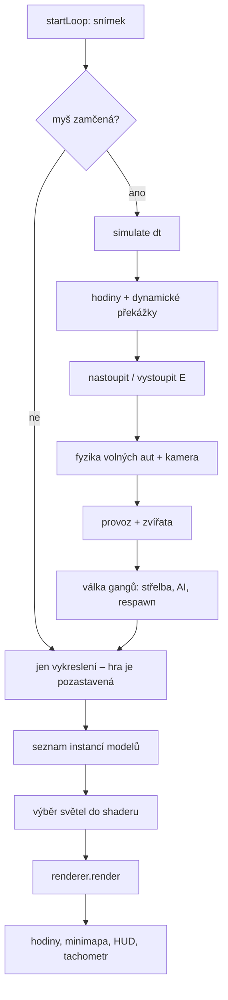

# Lost Heaven – jak hra vznikala

Tento dokument popisuje, jak je hra postavená: odkud se berou modely a textury, jak se
vykresluje město, jak funguje provoz, střídání dne a noci a herní logika války gangů.
Je určený pro každého, kdo chce v projektu pokračovat nebo pochopit, proč je něco
udělané tak, jak je.

## Obsah

1. [Technologie a spuštění](#1-technologie-a-spuštění)
2. [Struktura projektu](#2-struktura-projektu)
3. [Herní smyčka](#3-herní-smyčka)
4. [Souřadnice a matematika](#4-souřadnice-a-matematika)
5. [Generování města](#5-generování-města)
6. [Geometrie města](#6-geometrie-města)
7. [Textury](#7-textury)
8. [Obloha](#8-obloha)
9. [Renderer a shadery](#9-renderer-a-shadery)
10. [Světla](#10-světla)
11. [Modely glTF](#11-modely-gltf)
12. [Kolize a raycast](#12-kolize-a-raycast)
13. [Hráč, kamera a ovládání](#13-hráč-kamera-a-ovládání)
14. [Auta a řízení](#14-auta-a-řízení)
15. [Městský provoz](#15-městský-provoz)
16. [Zvířata v parcích](#16-zvířata-v-parcích)
17. [Den a noc](#17-den-a-noc)
18. [Válka gangů](#18-válka-gangů)
19. [Uživatelské rozhraní](#19-uživatelské-rozhraní)
20. [Assety a licence](#20-assety-a-licence)
21. [Testy a kvalita kódu](#21-testy-a-kvalita-kódu)
22. [Jak hru rozšiřovat](#22-jak-hru-rozšiřovat)

---

## 1. Technologie a spuštění

| Oblast         | Řešení                                                    |
| -------------- | --------------------------------------------------------- |
| Jazyk          | TypeScript (striktní režim, `noUncheckedIndexedAccess`)   |
| Build a server | Vite                                                      |
| Grafika        | čisté **WebGL2** – žádný Three.js ani jiný framework      |
| Testy          | Vitest (prostředí `node`, bez prohlížeče)                 |
| Kvalita        | ESLint + Prettier (`printWidth` 100, jednoduché uvozovky) |

```bash
npm install
npm run dev                      # vývojový server
npx tsc --noEmit -p .            # typová kontrola
npx vitest run                   # testy
npx eslint src tests             # lint
```

Grafická vrstva je napsaná ručně. Dává to plnou kontrolu nad tím, co se na GPU děje,
a hru je díky tomu možné ladit a testovat po malých kouscích. Cenou je, že věci jako
načítání modelů, světla nebo obloha si projekt dělá sám.

## 2. Struktura projektu

```
src/
  main.ts            vstupní bod: načte assety, sestaví svět, běží herní smyčku
  core/              smyčka, vstup, kamera, chůze, řízení auta, baterka, RNG
  math/              mat4, vec2, vec3
  gfx/               WebGL: kontext, buffery, shadery, textury, glTF, renderer, světla
  shaders/           GLSL: město, modely, obloha, sdílená světla
  city/              rozvržení města, mesh, textury, obloha, kolize, assety, stromy, lampy
  vehicle/           fyzika auta, napasování modelu, městský provoz
  animals/           zvířata v parcích
  people/            postavy (tělo, animace), gangsteři, držení zbraně
  game/              herní hodiny, pistole, válka gangů
  ui/                minimapa, tachometr, hodiny, bojový HUD
tests/               testy ve Vitestu, jeden soubor na oblast
public/              modely a textury servírované tak, jak jsou
assets-src/          zdrojové soubory assetů (fotky, licence), do hry se nenačítají
```

Každý modul má jednu zodpovědnost a většina logiky je psaná jako čisté funkce
nebo třídy bez závislosti na WebGL. Díky tomu jde testovat v Node bez prohlížeče:
provoz, střelba, hodiny, rozvržení města i parser glTF mají vlastní testy.

## 3. Herní smyčka

`src/main.ts` je jediné místo, kde se všechno potká. Postup při startu:

1. Vygeneruje se město (`generateCity`) a z něj kolize (`CityCollision`).
2. Paralelně se načtou textury, obloha a všechny modely (`Promise.all`). Každý model
   se načítá přes `loadOptionalModel` – když chybí, hra jen vypíše varování a pokračuje.
3. Vznikne `Renderer`, ze statických modelů se „upečou“ velké meshe (stromy, lampy).
4. Vytvoří se provoz, zvířata, gangsteři, hodiny a UI.
5. Spustí se `startLoop`, který každý snímek volá jednu funkci.



**Pauza:** dokud není myš zamčená (pointer lock), `simulate` se nevolá. Svět se dál
vykresluje, ale nic se nehýbe a herní čas stojí. Menu s ovládáním je tedy zároveň pauza.

`startLoop` (`core/loop.ts`) ořezává `dt` na 1/15 s, aby po přepnutí záložky nebo
zaseknutí jeden obří krok neprohodil auto zdí.

## 4. Souřadnice a matematika

- **Osa Y míří nahoru**, terén leží v rovině XZ, jednotkou je metr.
- **Kamera** (`core/camera.ts`) má `yaw` a `pitch`. `yaw = 0` se dívá do −Z a roste po
  směru hodin při pohledu shora, takže `yaw = π/2` míří do +X.
- **Auta** používají stejnou konvenci (`heading`): dopředu je `(sin h, −cos h)`,
  doprava `(cos h, sin h)`.
- **Modely** z Kenney kitů míří dopředu do +Z. `rotationY(a)` z `math/mat4.ts` otočí
  +Z na `(sin a, 0, cos a)`, proto auta používají `rotationY(π − heading)`.
- Matice jsou **column-major** jako v OpenGL, `multiply(a, b)` počítá `a · b`.

## 5. Generování města

Soubor `city/layout.ts`, funkce `generateCity`.

Město je mřížka **8 × 8 bloků**. Blok má 62 m, ulice 16 m, takže rozteč (`pitch`) je 78 m.
Pozor na důležitý detail: **šířka ulice 16 m zahrnuje oba chodníky** (po 4 m), vozovka
samotná má jen 8 m, tedy ±4 m od osy. Osa ulice číslo `k` leží na souřadnici `k · pitch`.

Celé město je deterministické – vychází z jednoho seedu (1930) a generátoru
**mulberry32** (`core/rng.ts`). Stejný seed vždy dá stejné město.

- **Budovy** se staví po obvodu každého bloku jako řadové domy. Výška roste směrem
  k centru (proměnná `density`), takže uprostřed je „downtown“.
- **Náměstí** – zhruba 9 % bloků zůstane prázdných a dlážděných.
- **Parky** – další bloky na okraji města se změní na park s trávou. Parky, stromy
  i lampy mají **vlastní generátor náhody**. Když se přidaly, žádná budova se tím
  neposunula a vlastní fasády (cílené na konkrétní souřadnice) zůstaly na místě.
- **Stromy** (`plantTrees`): podél každého chodníku (1,2 m od obrubníku, s volnými
  rohy kvůli přechodům), v kruhu kolem náměstí a v mřížce s náhodným posunem v parcích.
- **Lampy** (`placeLamps`): na každém rohu chodníku natočené do křižovatky a uprostřed
  stran bloku, vždy mimo stromy.

## 6. Geometrie města

Soubor `city/mesh.ts`. Celé statické město (silnice, chodníky, obrubníky, náměstí,
parky, fasády, střechy) je **jeden velký mesh** vykreslený jedním voláním.

Každý vrchol nese 16 čísel: pozici, normálu, tangentu (pro normal mapy), UV,
**číslo vrstvy textury** a barevný tón. Číslo vrstvy vybírá texturu z jednoho
`TEXTURE_2D_ARRAY`, takže všechny povrchy sdílí jeden shader i jednu texturu.

- **Silnice** se mapují přes šířku vozovky, aby textura s čarami seděla na krajnice
  a středovou čáru. Úseky končí před křižovatkou a křižovatky se kladou zvlášť.
- **Fasády** se mapují tak, že jedna dlaždice textury = jedna okenní osa a jedno
  podlaží. Proto okna na procedurální fasádě lícují s počtem pater budovy.
- **Terén** pokračuje 1,6 km za okraj města, aby hranici schovala mlha.

## 7. Textury

Soubory `city/textures.ts` a `city/assets.ts`.

Všechny povrchy se standardně **kreslí procedurálně** do canvasu 2048 × 2048: asfalt,
silnice s čarami, chodník, dlažba, cihly, omítka, střecha, tráva. Hra tak funguje i bez
jediného obrázku. Každá textura je kreslená tak, aby se bezešvě opakovala.

V `city/assets.ts` jde kteroukoli vrstvu nahradit obrázkem:

```ts
export const SURFACE_TEXTURES = {
  [TextureLayer.Road]: '/textures/road/Road008B_1K-JPG_Color.jpg',
  [TextureLayer.Grass]: '/textures/park/grass.png',
};
export const SURFACE_NORMAL_MAPS = {
  [TextureLayer.Road]: '/textures/road/Road008B_1K-JPG_NormalGL.jpg',
};
```

- Obrázky leží v `public/` a odkazují se absolutní cestou (`public/x.png` → `/x.png`).
- Normal mapy musí být v konvenci **OpenGL** (`NormalGL`, zelená nahoru), ne DirectX.
- Když obrázek nejde načíst, vypíše se varování a zůstane procedurální textura.
- **Vlastní fasády** (`CUSTOM_FACADES`, `city/facades.ts`): fotka celé stěny s udaným
  počtem oken a pater (`span`), přiřazená budovám podle souřadnic nebo podmínky.
  Každá vlastní fasáda dostane další vrstvu v texture array.

## 8. Obloha

Soubory `city/sky.ts`, `gfx/skybox.ts`, `shaders/skybox.*.glsl`.

- **Denní obloha** je procedurální cubemapa: přechod od obzoru do modré, mraky
  z šumu (fbm) a slunce v pevném směru `SUN_DIRECTION`. Místo ní jde načíst panorama
  (equirectangular obrázek), které se přepočítá na šest stěn kostky.
- **Noční obloha** je druhá cubemapa: téměř černá, slabá záře města u obzoru a hvězdy
  (každá hvězda je jeden texel s náhodným jasem).
- Skybox shader obě oblohy **prolíná** podle denního světla a přičítá teplou
  **soumračnou záři** u obzoru. Mlha ve městě má vždy stejnou barvu jako obzor,
  takže se město do oblohy plynule rozpouští.

## 9. Renderer a shadery

Soubor `gfx/renderer.ts`. Pořadí kreslení v každém snímku:

1. **Město** – jeden mesh, shader `city.vert/frag.glsl`: normal mapping, ambientní
   světlo podle orientace plochy, slunce, bodová světla a exponenciální mlha.
2. **Modely** – `gfx/model.ts`, shader `model.vert/frag.glsl`. Každý díl modelu má
   vlastní základní barvu a volitelnou **emisi** (svítící sklo lamp v noci).
3. **Obloha** – nakonec, aby ji test hloubky ořízl tam, kde už je město.

Všechny parametry osvětlení (barva a síla slunce, ambient, barva a hustota mlhy, síla
emise) se počítají každý snímek z denní doby – viz [Den a noc](#17-den-a-noc).

**Sdílený kód shaderů:** výpočet světel je v `shaders/lights.glsl` a do shaderu města
i modelů se vkládá na řádek `#include "lights.glsl"` funkcí `withLights()`
(WebGL `#include` neumí, tak se dělá textová náhrada před kompilací).

## 10. Světla

Soubory `gfx/lights.ts`, `shaders/lights.glsl`, `city/lamp.ts`, `vehicle/model.ts`,
`core/flashlight.ts`.

Všechna světla ve hře jsou **kuželová (spot)**: pozice, směr, barva × intenzita, dosah,
vnitřní a vnější úhel. Útlum je inverzní čtverec vzdálenosti, ořezaný tak, aby na
hranici dosahu klesl přesně na nulu.

Do shaderu se vejde nejvýš **32 světel** (`MAX_LIGHTS`). Každý snímek se proto vybírá:

1. baterka (klávesa T) a záblesky výstřelů,
2. světlomety až 8 nejbližších aut,
3. zbytek slotů pro nejbližší pouliční lampy.

Funkce `nearestLights` nejvzdálenější vybraná světla plynule ztlumí. Když se při
pohybu kamery sada mění, světlo, které vypadne nebo přibude, je v tu chvíli už
skoro zhasnuté – nic neproblikává.

| Zdroj     | Intenzita      | Dosah | Poznámka                                     |
| --------- | -------------- | ----- | -------------------------------------------- |
| Lampa     | 100            | 34 m  | teple žlutá, svítí dolů z lucerny            |
| Světlomet | 220            | 80 m  | jeden kužel ze středu kapoty, mírně skloněný |
| Baterka   | jako světlomet | 80 m  | z kamery, kam se díváte                      |
| Výstřel   | krátký záblesk | 14 m  | 0,07 s                                       |

## 11. Modely glTF

Soubory `gfx/gltf.ts`, `gfx/model.ts`, `gfx/batch.ts`.

Hra má **vlastní minimalistický parser binárního glTF (.glb)**. Čte jen to, co
potřebuje: trojúhelníkové meshe, pozice, normály, jednu sadu UV, hierarchii uzlů,
barvu materiálu a jednu texturu. Co neumí (komprese Draco, kostra, morph targety),
odmítne s jasnou chybou, místo aby nakreslil nesmysl.

Jak se model skládá:

- **Každý uzel s meshem je samostatný díl** pojmenovaný podle uzlu (`wheel-front-left`,
  `leg-left`, `arm-right`…). Na tom stojí všechny animace ve hře – loader neumí
  animace z glTF, ale díly se dají natáčet v kódu.
- Uzel s více materiály se rozdělí na **více dílů se stejným jménem**, každý s vlastní
  barvou (stromy z Nature Kitu mají korunu a kmen jako dva barevné materiály).
- Ze sdíleného vertex bufferu se do dílu zkopírují jen vrcholy, které opravdu používá.
- Textury s relativní cestou se hledají vedle modelu – Kenney kity očekávají
  `Textures/colormap.png` ve stejné složce jako `.glb`.
- Rozšíření `KHR_materials_unlit` a `KHR_texture_transform` (identita) se tolerují –
  potřebují je postavy z Blocky Characters. „Unlit“ materiály se přesto stínují, aby
  postavy patřily do noční scény.

**Pózování dílů:** každá instance modelu může mít funkci `pose(part)`, která pro díl
vrátí dodatečnou transformaci v jeho vlastním prostoru. Počátek uzlu je u Kenney
modelů přesně kloub – osa kola, kyčel, rameno – takže stačí rotace.

**Pečení statických modelů:** stromů jsou stovky a lamp kolem pěti set. `bakeInstances`
je při startu přepočítá do světových souřadnic a slije do **jednoho meshe na díl**.
Všechny stromy a lampy dohromady pak stojí jen pár vykreslovacích volání.

**Procedurální lampa** (`city/lamp.ts`) je model složený z kvádrů přímo v kódu (patka,
sloup, rameno, stříška a svítící sklo). Kdykoli ji jde nahradit glTF modelem.

## 12. Kolize a raycast

Soubor `city/collision.ts`.

- **Statické překážky** – budovy, kmeny stromů, sloupy lamp – jsou obdélníky
  v mřížce buněk 20 × 20 m. Dotaz projde jen pár buněk kolem bodu.
- **Dynamické překážky** – auta – se každý snímek předají přes `setObstacles()` jako
  natočené obdélníky. Dotaz může vlastní překážku ignorovat (`ignore`), aby auto
  nenaráželo samo do sebe.
- `resolve()` posouvá kruh (chodce) zvlášť po ose X a Z, takže podél zdi klouže.
- `groundHeightAt()` vrací výšku chodníku (obrubník 15 cm) nebo 0 na silnici.
- `raycast()` krokuje paprsek po 20 cm a zastaví se o zem, budovu (podle její výšky),
  kmen, sloup nebo auto. Používá se pro střelbu a pro to, jestli gangster hráče vidí.

## 13. Hráč, kamera a ovládání

- **`core/input.ts`** – klávesnice a myš přes pointer lock. Rozlišuje „drženo“
  a „stisknuto tento snímek“. Tlačítka myši se počítají jen při zamčené myši, takže
  klik, který myš zamyká, nevystřelí.
- **`core/controller.ts`** – chůze (výška očí, kolize, skok mezerníkem s gravitací)
  a létání (`F`) pro prohlížení města shora.
- **`core/camera.ts`** – perspektivní kamera, `horizontalFov()` pro výseč na minimapě.
- **`core/flashlight.ts`** – baterka z kamery se stejnou silou jako světlomet.

## 14. Auta a řízení

Soubory `vehicle/vehicle.ts`, `vehicle/model.ts`, `core/drive.ts`.

- **Fyzika** je arkádový kinematický „bicycle“ model: auto jede ve směru natočení,
  zatáčí podle úhlu kol a rozvoru, takže se neotočí na místě a ve vysoké rychlosti
  zatáčí široce. Kolize je řada kruhů podél auta testovaná proti městu.
- **Napasování modelu** (`fitVehicle`): rozměry, poloměr kol a rozvor se změří přímo
  z modelu. Kola se najdou podle jmen dílů – vše začínající `wheel-` se točí,
  `wheel-front` navíc zatáčí.
- **Řízení** (`DriveController`): kamera za autem s mírným zpožděním, myší jde
  rozhlížet, při jízdě se pohled vrátí za auto. Vystupuje se na straně řidiče, nebo
  tam, kde je volno.
- **Libovolné auto:** klávesou `E` jde nastoupit do vlastní sanitky, do odstaveného
  auta i do kteréhokoli auta z provozu. Auto z provozu se tím natrvalo vyřadí
  (`Traffic.remove`) a stane se z něj „volné auto“: řídí ho hráč, a když ho opustí,
  zůstane stát s ruční brzdou.

## 15. Městský provoz

Soubor `vehicle/traffic.ts`. Po městě jezdí 100 aut náhodně vybraných podle vah
z `TRAFFIC_CARS` (sedany a taxíky častěji, hasiči vzácně).

**Silniční síť** (`buildRoadNetwork`): křižovatky na všech vnitřních ulicích (okrajové
mají poloviční šířku, tam se nejezdí), mezi nimi pruhy po jednom v každém směru.
Na každé křižovatce jsou předpočítané cesty: rovně, oblouk doprava s poloměrem 2 m
a oblouk doleva s poloměrem 6 m přes protisměr. Test ověřuje, že ani hasičský vůz
v žádné zatáčce nezajede na chodník.

**Auta jedou kinematicky po cestách** (bez fyziky), takže nikdy nevyjedou z pruhu.
Na konci pruhu si náhodně vyberou směr (rovně má dvojnásobnou šanci).

**Křižovatky** fungují na rezervaci:

- Auto se 6 m před čárou zeptá, jestli smí jet. Současně smí v křižovatce být jen auta
  ze stejného směru, nebo protijedoucí, pokud ani jedno neodbočuje vlevo.
- Vjet smí jen tehdy, když je **za křižovatkou místo** – včetně aut, která do
  stejného pruhu právě odbočují. Křižovatku tak nikdo neucpe.
- Když auto na místo čeká přes 4 s, vybere si jiný směr.

**Jízda za sebou:** auto se dívá 40 m dopředu **po své vlastní budoucí trase**
(nikoli rovným paprskem) a brzdí tak, aby drželo 2 m odstup. První verze se dívala
paprskem rovně – auta v půlce zatáčky pak „viděla“ auta čekající na vedlejší ulici
a celé město se postupně zablokovalo. Druhá chyba byla, že auto zastavovalo středem
místo předním nárazníkem na čáře a strkalo čumák do křižovatky.

Provoz zastaví i před hráčem pěšky, před jeho autem a před gangsterem v silnici.

## 16. Zvířata v parcích

Soubor `animals/animal.ts`. Do každého parku přijde 3–7 náhodných zvířat
z Kenney Cube Pets. Chodící zvířata si vybírají náhodné body v parku, dojdou k nim,
chvíli postojí a obcházejí kmeny. Papoušek a včela krouží ve výšce 2,5–8 m. Každý cíl
i krok je omezený na plochu parku. Nohy kmitají do kříže a křídla mávají – opět přes
`pose()` nad pojmenovanými díly.

## 17. Den a noc

Soubory `game/clock.ts`, `gfx/renderer.ts`, `ui/clock.ts`.

- **Herní hodiny** (`GameClock`): hra začíná v **7:00** a jeden herní den trvá
  **5 minut** reálného času (`DAY_LENGTH_SECONDS`, `START_HOUR`). V menu čas stojí.
- **Výška slunce** se počítá z hodiny: východ v 6:00, poledne ve 12:00, západ v 18:00.
  Z ní `daylightAt()` odvodí tři plynulé hodnoty od 0 do 1:
  - `daylight` – kolik je denního světla (slunce, ambient, mlha, prolnutí oblohy),
  - `dusk` – teplá záře při východu a západu (oranžové slunce, záře u obzoru),
  - `lights` – jak moc svítí lampy, jejich sklo a světlomety.
- Renderer všechny parametry **lineárně míchá** mezi denními a nočními hodnotami,
  takže soumrak trvá zhruba 20 s a nic se nepřepíná skokem.
- Klávesa `N` nebo tlačítko přeskočí čas na 21:00, resp. ráno na 7:00.
- **Ciferník** vpravo nahoře je kreslený do canvasu podle předlohy: zlatý prstenec
  se sluncem pro den, modrý s hvězdami a měsícem pro noc, a otáčí se tak, aby
  aktuální čas byl vždy pod ukazatelem.

## 18. Válka gangů

Soubory `game/gangwar.ts`, `game/pistol.ts`, `people/body.ts`, `people/gangster.ts`,
`people/weapon.ts`.

**Cíl hry:** město je rozdělené na 16 čtvrtí po 2 × 2 blocích. Konkurenční gang drží
6 z nich (nikdy tu, kde hráč začíná), v každé 4–6 gangsterů. Čtvrť je dobytá, když
v ní nezůstane živý gangster. Kdo dobyde všechny, vyhrál.

| Událost        | Body |
| -------------- | ---- |
| Zneškodnění    | +100 |
| Zásah do hlavy | +50  |
| Dobytá čtvrť   | +500 |
| Smrt hráče     | −250 |

**Postavy** (`people/body.ts`) jsou modely z Kenney Blocky Characters. Nemají kostru –
nohy, ruce a hlava jsou samostatné díly – takže se animují stejně jako zvířata:

- chůze kývá nohama a rukama,
- míření zvedne pravou ruku s pistolí před sebe,
- po smrti postava padne na záda (rotace celého těla kolem chodidel),
- zásahové zóny jsou koule pro hlavu a svislý válec pro tělo.

**Gangster** (`people/gangster.ts`) je jednoduchý stavový automat:

1. **Hlídka** – chodí po chodníku kolem svého bloku.
2. Každých 0,25 s se podívá, jestli hráče vidí (do 40 m, paprsek nesmí nic přerušit).
3. **Boj** – otočí se, zvedne zbraň, přiblíží se na 14 m a střílí každých 0,9–1,7 s.
   Šance zásahu klesá se vzdáleností a je nižší, když hráč sedí v autě.
4. Když hráče 6 s nevidí nebo když hráč zemře, vrátí se na hlídku.

**Hráč** (`fight()` v `main.ts`): levé tlačítko vystřelí paprsek z kamery. Zasažený
je nejbližší gangster na paprsku, pokud před ním není zeď nebo auto. Pistole má
8 nábojů, přebíjí se 1,4 s (klávesou R nebo sama po vystřílení). Tělo vydrží tři
zásahy, hlava jeden. Gangstera jde také přejet autem rychlejším než 4 m/s.

Hráč má 100 životů, po 5 s bez zásahu se doplňují. Po smrti se za 2,5 s objeví
na startovní křižovatce a všichni gangsteři ho přestanou hledat.

**Zbraň** (`people/weapon.ts`) je Kenney Blaster Kit (`blaster-b`):

- v pohledu hráče se kreslí přilepená ke kameře, s cuknutím po výstřelu,
- v ruce gangstera je připojená ke konci pravé ruky, takže když ruku zvedne, zbraň míří.

## 19. Uživatelské rozhraní

Všechno UI je HTML a canvas 2D nad WebGL plátnem (`index.html`, `src/ui/`).

- **Minimapa** (vlevo nahoře): město se jednou vykreslí do velkého canvasu a každý
  snímek se z něj vyřízne okolí kamery. Výseč ukazuje skutečný vodorovný zorný úhel.
  Auta jsou natočené obdélníčky, čtvrti gangu červené, dobyté zelené, gangsteři tečky.
- **Tachometr** (vpravo dole, při řízení): analogový budík podle Mafie s otáčkoměrem
  a počítadlem kilometrů. Auto převodovku nemá – stupeň a otáčky se dopočítávají
  z rychlosti (`engine()` v `ui/speedometer.ts`).
- **Hodiny** (vpravo nahoře) – viz [Den a noc](#17-den-a-noc).
- **Bojový HUD**: životy, náboje, skóre a počet dobytých čtvrtí, zprávy uprostřed
  obrazovky, červený záblesk po zásahu, zčervenalý zaměřovač po zásahu gangstera.
- **Menu** s ovládáním je zároveň pauza; ladicí řádek vlevo dole ukazuje fps a pozici.

## 20. Assety a licence

Všechny modely jsou **CC0** od Kenneyho, textura silnice od ambientCG (CC0).

| Složka                   | Obsah                  | Zdroj                      |
| ------------------------ | ---------------------- | -------------------------- |
| `public/models/`         | sanitka hráče, stromy  | Kenney Car Kit, Nature Kit |
| `public/models-car/`     | auta do provozu        | Kenney Car Kit             |
| `public/models-animals/` | zvířata                | Kenney Cube Pets           |
| `public/models-people/`  | postavy                | Kenney Blocky Characters   |
| `public/models-weapons/` | zbraně                 | Kenney Blaster Kit         |
| `public/textures/`       | silnice, tráva, fasáda | ambientCG, vlastní fotka   |

Vše, co jde nastavit bez programování, je soustředěné v **`src/city/assets.ts`**:
textury povrchů a normal mapy, vlastní fasády, auto hráče, modely provozu a jejich
váhy, počet aut, druhy stromů, zvířata a jejich výšky, postavy gangsterů a pistole.

## 21. Testy a kvalita kódu

Testy běží v Node bez prohlížeče (`npx vitest run`). Pokrývají mimo jiné:

- generování města (determinismus, budovy uvnitř bloků, parky, stromy, lampy),
- mesh města a mapování fasád, parser glTF na skutečných modelech,
- fyziku auta a napasování modelu, provoz se 100 auty po 4 minuty bez srážky
  a bez zácpy, vyřazení auta z provozu,
- výběr a balení světel, noční oblohu, hodiny a plynulost soumraku,
- zvířata (nikdy neopustí park), postavy, gangstery, pistoli a bodování.

Grafika samotná (shadery, WebGL) se ověřuje ručně ve hře. Kód se kontroluje
`tsc --noEmit`, ESLintem a formátuje Prettierem.

## 22. Jak hru rozšiřovat

**Nový model auta do provozu:** soubor `.glb` do `public/models-car/` (kola pojmenovaná
`wheel-…`, přední `wheel-front-…`) a řádek do `TRAFFIC_CARS` v `city/assets.ts`.

**Nová textura povrchu:** obrázek do `public/textures/` a položka do
`SURFACE_TEXTURES` (případně normal mapa do `SURFACE_NORMAL_MAPS`).

**Nový druh stromu nebo zvíře:** model do příslušné složky a záznam do
`TREE_MODELS` / `PARK_TREES`, resp. `ANIMALS` s výškou v metrech.

**Animovaný model:** loader neumí animace z glTF ani kostru. Použijte modely,
kde jsou pohyblivé části samostatné uzly, a rozpohybujte je funkcí `pose()`.

**Ladění hratelnosti:**

| Co                             | Kde                                    |
| ------------------------------ | -------------------------------------- |
| délka dne, začátek hry         | `game/clock.ts`                        |
| počet čtvrtí gangu a gangsterů | `DEFAULT_GANG_WAR` v `game/gangwar.ts` |
| body, životy, regenerace       | `game/gangwar.ts`                      |
| chování gangsterů              | konstanty v `people/gangster.ts`       |
| zásobník a přebíjení           | `game/pistol.ts`                       |
| počet aut, modely provozu      | `city/assets.ts`                       |
| síla lamp a světlometů         | `city/lamp.ts`, `vehicle/model.ts`     |
| noční tma, mlha                | konstanty v `gfx/renderer.ts`          |
